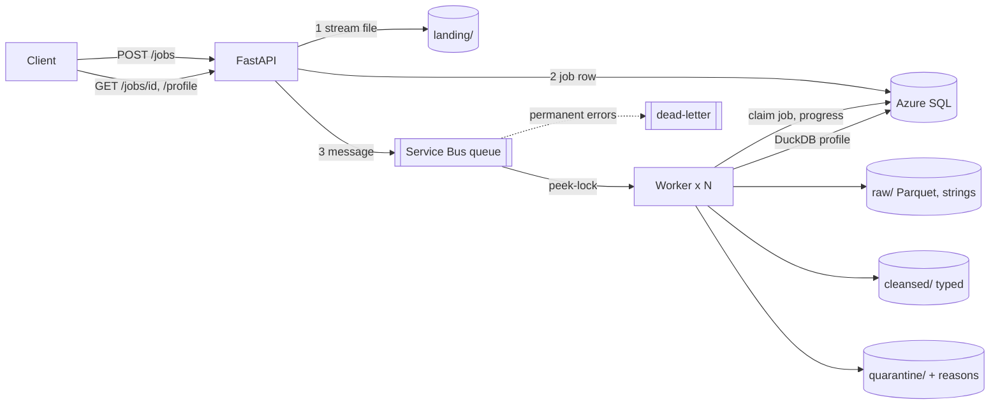

# Lakeflow

A queue-driven ingestion pipeline. It takes CSV, Excel and XML files, lands them in an
Azure data lake, converts them to Parquet, profiles every column, then validates,
deduplicates and types the data, with every rejected row kept alongside its reasons.

Python 3.11+ · Polars · DuckDB · Parquet · Azure Blob / ADLS Gen2 · Azure Service Bus ·
SQLAlchemy 2 + Alembic (Azure SQL / SQL Server) · FastAPI · pytest · Docker

## How it fits together



Per file, the worker runs: **download → detect → convert → profile → transform → publish**,
writing the stage and a percentage to the job row as it goes.

## Lake layout

```
lake/
  landing/source=sap_bp/ingest_date=2026-10-25/<sha256>/partners.csv     original, immutable
  raw/source=sap_bp/ingest_date=2026-10-25/<sha256>/part-00000.parquet   all columns as strings
  cleansed/.../<sha256>/part-00000.parquet                               typed, valid, deduplicated
  quarantine/.../<sha256>/part-00000.parquet                             rejected rows + reasons
  curated/                                                               business outputs (SAP files)
  each folder ends with _SUCCESS, written last
```

Lifecycle rules (`infra/lifecycle-policy.json`): landing moves to cool storage after 30 days,
archive after 90, and is deleted after 365; quarantine is deleted after 90.

## Benchmark (measured)

1,050,000 rows, 121 MB, cp1252-encoded, semicolon-separated CSV, on 2 vCPUs / 7 GB RAM:

| Stage | Time |
| --- | --- |
| Detect + convert to Parquet (streaming) | 1.1 s |
| Transform: cleanse, type, validate, dedupe | 7.8 s |
| Full worker run incl. DuckDB profiling and publishing | 20.1 s |
| Peak memory, full run | ~1.1 GB |

Results matched the planted defects exactly: 950,000 valid, 50,000 rejected,
20,000 exact duplicates, 30,000 older key versions. Reproduce with `pytest -m slow -s`.

## Design decisions

- **Raw zone keeps everything as strings.** Type inference guesses from early rows; a bad
  value at row 900,000 would crash the load or become a silent null. Typing happens in
  cleansing, where failures are recorded per row.
- **Detect from bytes, not the extension.** Magic bytes, then BOM, then strict UTF-8, then a
  statistical guess that prefers cp1252. A source can declare its encoding (`?encoding=`),
  and a declaration always beats a guess. Close code pages (cp1250 vs cp1252) agree on "ü"
  but not on "ø", and the tests check both.
- **Idempotent worker.** A conditional `UPDATE ... WHERE status='QUEUED' OR lease expired`
  claims a job, so only one worker wins. A finished job redelivered is completed without
  doing any work. Outputs go to deterministic, hash-based paths: clear, write, then
  `_SUCCESS`.
- **Two kinds of failure.** Permanent errors (bad format, contract mismatch) are
  dead-lettered immediately. Anything else is retried by abandoning the message, up to
  `MaxDeliveryCount`.
- **Validation collects every problem.** A rejected row lists all its failures
  (`email:pattern;credit_limit:min`), not just the first.
- **Key dedupe runs after validation.** A broken newer record cannot knock out a good
  older one.
- **Never truncate for SAP.** A value longer than the template field is a rejected row.
- **Synthetic data only.** `lakeflow.synth` plants defects at known positions and writes a
  manifest; tests assert exact counts.
- **No secrets in code.** Settings come from environment variables. In Azure, the services
  use managed identity (`AZURE_STORAGE_ACCOUNT_URL`, `SERVICEBUS_NAMESPACE`) and the Bicep
  template disables account keys.

## Run it

```bash
pip install -e ".[dev]"
pytest -q                                   # unit + integration tests
alembic upgrade head                        # SQLite by default
python -m lakeflow.synth --rows 100000 --out data/bp.csv --encoding cp1252 --delimiter ";"
lakeflow run data/bp.csv --source sap_bp    # one-shot local run, prints the summary
```

Full local Azure stack (Azurite, SQL Server, Service Bus emulator, API, two workers):

```bash
cp .env.example .env
docker compose up --build
curl -F "file=@data/bp.csv" "localhost:8000/jobs?source=sap_bp"
curl localhost:8000/jobs/<id>
curl localhost:8000/jobs/<id>/profile
```

Storage integration tests run against Azurite when `AZURITE_CONNECTION_STRING` is set
(see `tests/test_azurite.py`; CI starts Azurite as a service).

## Repository map

| Path | What it does |
| --- | --- |
| `src/lakeflow/detect.py` | Format, encoding and delimiter detection |
| `src/lakeflow/ingest.py` | CSV / Excel / XML → Parquet, streaming |
| `src/lakeflow/profile.py` | Column profiling in DuckDB SQL |
| `src/lakeflow/transform.py` | Contract-driven cleansing, validation, deduplication |
| `src/lakeflow/worker.py` | Idempotent Service Bus worker with progress |
| `src/lakeflow/api.py` | FastAPI: submit, status, profile, retry |
| `src/lakeflow/db.py` | SQLAlchemy 2 models |
| `src/lakeflow/storage.py` | Local and Azure Blob / ADLS Gen2 storage |
| `src/lakeflow/queue.py` | In-memory and Service Bus queues |
| `src/lakeflow/sap_dct.py` | SAP Migration Cockpit import rows |
| `src/lakeflow/synth.py` | Synthetic data with injected defects |
| `migrations/` | Alembic migrations (`docs/schema_sqlserver.sql` is the SQL Server DDL) |
| `contracts/` | Data contract and SAP field list (JSON) |
| `infra/` | Bicep and storage lifecycle policy |

## Known limits and next steps

- Transform materialises the typed frame (about 1 GB at 1M rows). Beyond that, split the
  input by `hash(key)` into partitions and transform each one.
- Profiling is the slowest stage. Patterns could be computed on a sample, or all
  columns could be profiled in a single UNPIVOT pass.
- Excel is read one sheet at a time, not streamed.
- For 2 GB uploads, clients should upload directly to Blob with a SAS URL; an Event Grid
  event then creates the job, instead of streaming through the API.
- A job row is committed before its message is sent. If the send fails, `POST
  /jobs/{id}/retry` re-sends it; a transactional outbox would close that gap fully.
